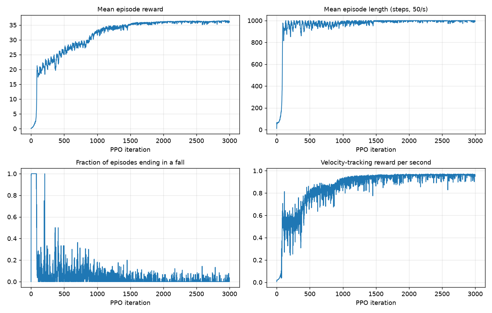
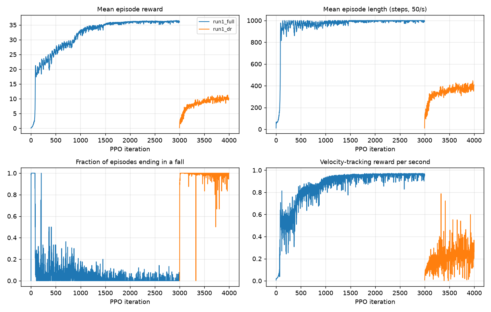
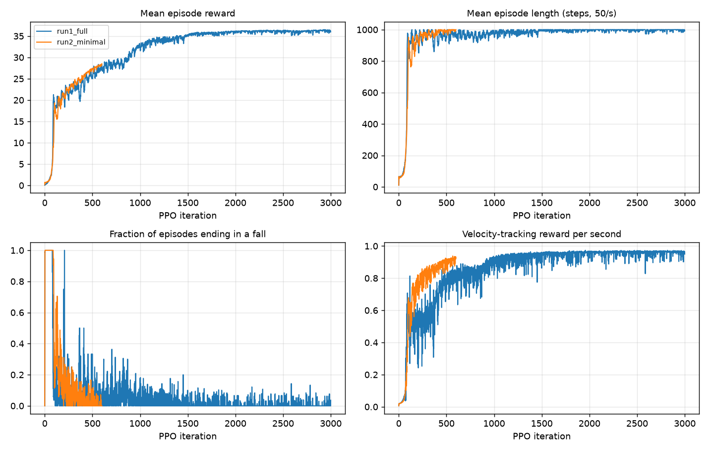

# G1 walking with PPO on CPU (MuJoCo + rsl_rl)

project: train a Unitree G1 (12-DoF legs) to walk in MuJoCo with PPO,
on a laptop CPU (no GPU / Isaac Gym needed).

## Setup

```bash
uv venv --python 3.11 .venv
uv pip install --python .venv/bin/python -r requirements.txt
git clone --depth 1 https://github.com/unitreerobotics/unitree_rl_gym reference/unitree_rl_gym      # robot model + reference
git clone --depth 1 https://github.com/Lavansurendra/berkeley_humanoid reference/berkeley_humanoid  # pipeline reference
```

## Run

```bash
source .venv/bin/activate
python train.py --iters 3000 --envs 1024 --name run1_full        # ~80 min on an M4 MacBook
tensorboard --logdir logs/g1                                     # live curves (optional)
python plot_curves.py logs/g1/run1_full                          # -> results/curves.png
python play.py logs/g1/run1_full/model_2999.pt                   # -> logs/g1/run1_full/walk.mp4
./view.sh logs/g1/run1_full/model_2999.pt --seconds 60           # live viewer window
python play.py --unitree                                         # Unitree's pretrained policy, for comparison
python train.py --dr --resume logs/g1/run1_full/model_2999.pt --iters 1000 --name run1_dr  # robustness stage
python evaluate.py logs/g1/run1_dr/model_3998.pt --dr           # % of 256 robots that fall in 20 s
```

## How the pipeline fits together

```
               ┌──────────────────────── rsl_rl OnPolicyRunner (train.py) ───────────────────────┐
               │                                                                                 │
 observations  │   actor MLP ──► action (12 joint offsets, sampled from a Gaussian)               │
  (47 numbers) │   critic MLP ──► value estimate                                                 │
               │                                                                                 │
               │   collect 24 steps × 1024 robots ──► GAE advantages ──► 5 epochs of clipped     │
               │   PPO updates on the batch ──► repeat                                           │
               └─────────────────────────────────────────────────────────────────────────────────┘
                       ▲ obs, reward, done                         │ actions
                       │                                           ▼
       g1_walk/env.py  (task logic: commands, observations, 16 reward terms, falls, resets, DR)
                       ▲ joint/base/foot state                      │ PD targets = default + 0.25·action
                       │                                           ▼
       g1_walk/physics.py (MuJoCo: 8 CPU worker processes, 4 × 5 ms physics steps per 20 ms policy step,
                           PD control  τ = kp·(target − q) − kd·q̇  inside MuJoCo)
```

| File | What it does |
|---|---|
| `g1_walk/config.py` | Every setting: timing, PD gains, observation scales, command ranges, reward weights, DR ranges, PPO hyperparameters |
| `g1_walk/physics.py` | Loads the G1 model, turns motors into PD actuators, steps many robots in parallel worker processes |
| `g1_walk/env.py` | The RL task: builds observations, computes rewards, detects falls, resets, randomizes |
| `train.py` | Plugs the env into rsl_rl's PPO runner; saves checkpoints and TensorBoard logs |
| `play.py` | Deterministic rollout (policy mean, no noise) → video or live viewer |
| `plot_curves.py` | Reward / episode-length / fall-rate plots from TensorBoard logs |
| `evaluate.py` | Robustness test: % of robots that fall in 20 s, with or without randomization |
| `gait_stats.py` | Gait-quality numbers (foot clearance, slip, jitter, ...) to compare policies |
| `view.sh` | Opens the live MuJoCo viewer (wraps `mjpython`) |

## Design choices

**Observation (47 values, actor):** base angular velocity, projected gravity (torso tilt), commanded
(vx, vy, yaw rate), joint positions relative to the default pose, joint velocities, previous action,
and a sin/cos gait clock (0.8 s period). This is exactly the layout Unitree's `deploy_mujoco.py` uses,
so our policies and theirs are interchangeable. The **critic** additionally gets the true base linear
velocity (a "privileged" observation a real robot can't measure directly; the critic is only used
during training, so it can cheat).

**Action (12 values):** offsets added to the default standing pose, scaled by 0.25 rad, used as PD
position targets. Gains from Unitree's config (hips 100, knees 150, ankles 40 N·m/rad).

**Timing:** physics at 200 Hz, policy at 50 Hz, 20 s episodes; velocity command resampled every 10 s
(vx ∈ [−0.5, 1.0], vy ∈ [−0.3, 0.3], yaw ∈ [−0.5, 0.5] rad/s; 10% of robots told to stand still).

**Episode ends** when the pelvis drops below 0.4 m or the torso tilts more than 60°, or at the 20 s
time limit (time-outs are flagged so PPO bootstraps the value instead of treating them as failures).

**Reward function** (each term × weight × 0.02 s, summed each step, clipped at ≥ 0):

| Term | Weight | Formula | Why it's there |
|---|---|---|---|
| tracking_lin_vel | +1.0 | exp(−‖v_cmd,xy − v_xy‖² / 0.25) | the main objective |
| tracking_ang_vel | +0.5 | exp(−(ω_cmd − ω_z)² / 0.25) | turn when asked |
| alive | +0.15 | 1 | don't fall |
| contact | +0.18 | # feet whose contact matches the gait clock | alternate left/right steps |
| torques | −1e-5 | Σ τ² | energy efficiency |
| lin_vel_z | −2.0 | v_z² | no bouncing |
| ang_vel_xy | −0.05 | ω_x² + ω_y² | no torso wobble |
| orientation | −1.0 | g_x² + g_y² | stay upright, don't lean to "fall forward" |
| base_height | −10 | (h − 0.78)² | don't crouch |
| dof_acc / dof_vel | −2.5e-7 / −1e-3 | Σ q̈², Σ q̇² | smooth, non-jittery joints |
| action_rate | −0.01 | Σ (a_t − a_{t−1})² | smooth actions |
| dof_pos_limits | −5.0 | distance past 90% of joint range | don't slam into limits |
| hip_pos | −1.0 | hip roll² + hip yaw² | no splayed / twisted legs |
| contact_no_vel | −0.2 | foot velocity² while in contact | no foot sliding |
| feet_swing_height | −20 | (foot z − 0.08)² while in the air | lift feet ~8 cm, no shuffling |

`--reward minimal` keeps only the first three terms + torques (the doc's suggested starting point)
so the effect of the extra terms can be compared directly.

**Domain randomization** (`--dr`, a second training stage once walking works): friction 0.55–1.125,
pelvis mass −1 to +3 kg, motor strength (kp, kd) ×0.9–1.1, torso velocity set to a random value up to
1.5 m/s every 5 s (a shove), and uniform sensor noise on observations. These match Unitree's settings.
Note on friction: Unitree randomizes robot friction 0.1–1.25 against a ground of 1.0, and Isaac Gym
*averages* the two (effective 0.55–1.125); MuJoCo takes the *max* of the two surfaces, so setting only the
floor does nothing. We set the effective value on every geom.

**PPO (rsl_rl defaults from legged_gym):** actor and critic MLPs [256, 128, 128] with ELU, observation
normalization, 24 steps × 1024 envs per iteration (24,576 samples), 5 epochs × 4 minibatches,
clip 0.2, γ = 0.99, λ = 0.95, entropy 0.01, adaptive learning rate targeting KL = 0.01.

## Differences from unitree_rl_gym

- MuJoCo instead of Isaac Gym, CPU instead of GPU: ~1,000 robots instead of 4,096, ~15–20k steps/s.
- MLP policy instead of Unitree's LSTM (simpler; the gait clock gives the policy the timing it needs).
- Command ranges narrowed for faster CPU training.
- Termination on height/tilt instead of pelvis contact (pelvis has no collision geometry in the MJCF).
- Training models drop the visual meshes (no mass, no collision), which made startup 50× faster and
  memory use ~100× smaller; `play.py` uses the full model for rendering.

**Validation:** Unitree's own pretrained policy (`python play.py --unitree`) walks at 0.46 m/s for a
0.5 m/s command with no falls in this environment, which confirms the physics, PD gains, joint order and
observation layout match theirs.

## Results (M4 MacBook Pro, CPU only)

**Stage 1, base walking** (`run1_full`, 3000 iterations, 1024 robots, 74M samples, ~80 min):



- Iterations 0–90: every robot falls within ~1.5 s. Around iteration 90 it suddenly learns to balance and
  episode length jumps to the 20 s maximum.
- Iterations 90–1500: it already survives, so the gains now come from tracking the commanded velocity
  better (tracking reward 0.5 → 0.95 of a possible 1.0). Fall rate drops to a few percent.
- By iteration 600 (~15 min) it walks forward at the commanded speed (`results/walk_iter600.mp4`).

Final policy, deterministic 10 s rollouts (`python play.py ... --vx V`):

| Command | Actual speed | Falls |
|---|---|---|
| 0.5 m/s forward | 0.48 m/s | 0 |
| 1.0 m/s forward | 0.96 m/s | 0 |
| 0.3 m/s backward | 0.24 m/s | 0 |
| 0.5 m/s + 0.5 rad/s turn | walks a ~1 m radius circle | 0 |
| *Unitree's pretrained policy, 0.5 m/s* | *0.46 m/s* | *0* |

Videos: `results/walk_final_*.mp4`.

**Stage 2, domain randomization** (`run1_dr`, +1000 iterations from the stage-1 checkpoint, ~27 min):



(The training curves look much worse in stage 2 because every robot gets shoved every 5 s and many fall;
the "tracking reward per second" divides by the full 20 s even for episodes that end early.)

Robustness test, 128–256 robots, one 20 s episode each, % that fell (`evaluate.py`):

| Condition | Stage 1 policy | Stage 2 (DR) policy |
|---|---|---|
| Nominal (no randomization) | 0% | 0% |
| Sensor noise only | **100%** | **0%** |
| Friction / mass / motor strength (+ noise) | 98–100% | 3–4% |
| Shoves up to 0.5 m/s | 100% | 20% |
| Shoves up to 1.0 m/s | 100% | 52% |
| Shoves up to 1.5 m/s (training setting) | 100% | 91% |

Takeaways:
- The stage-1 policy is extremely brittle: tiny sensor noise alone makes every robot fall. It had
  learned to rely on perfectly clean joint-velocity readings. This is exactly why DR matters for sim2real.
- After DR it ignores noise, friction, mass and motor changes, and tracking error only rises from 0.064 to
  0.109 m/s in nominal conditions.
- Recovering from strong shoves is the remaining weakness. Unitree trains ~10,000 iterations × 4,096 envs
  (~1B samples, GPU); we used ~100M. More iterations (or a push curriculum that ramps 0.5 → 1.5 m/s) is the
  obvious next step, and a good use of GPU time.

## Minimal vs. full reward

The doc suggests starting with a minimal reward (velocity tracking + alive + torque penalty) and adding
terms only for specific bad behaviors. We trained the minimal set (`run2_minimal`, 600 iterations) and
compared it with the full set at the same iteration.



**By the training curves alone, the minimal reward looks as good or better.** It never falls and tracks
velocity *faster* (0.92 vs 0.81, averaged over iterations 550–600), because it has nothing else to trade off against.
(The total-reward curves aren't comparable: the two runs sum different terms.)

**The gait tells a different story** (`python gait_stats.py ...`, 64 robots, 0.5 m/s, 10 s):

| | Minimal (iter 600) | Full (iter 600) | Full (iter 3000) |
|---|---|---|---|
| forward speed | 0.46 m/s | 0.46 m/s | 0.48 m/s |
| falls | 0% | 0% | 0% |
| time with both feet on the ground | **67%** | 35% | 10% |
| swing-foot clearance | **1.1 cm** | 1.8 cm | 3.3 cm |
| planted-foot slip | **0.39 m/s** | 0.14 m/s | 0.04 m/s |
| action change per step (jitter) | **0.92** | 0.26 | 0.11 |
| torso tilt | 2.2° | 2.5° | 1.9° |
| pelvis height | 0.767 m | 0.784 m | 0.781 m |

The minimal-reward robot **shuffles**. It keeps both feet down two thirds of the time, barely lifts them,
slides them along the floor, and its commands vibrate from step to step (8× more jitter than the final
policy). In simulation this "works", but on hardware sliding feet need perfect friction and that much
jitter would overheat the motors. Video: `results/walk_minimal_reward.mp4`.

Which terms fix which problem:
- shuffling / both feet down → `contact` (gait clock) and `feet_swing_height`
- foot sliding → `contact_no_vel`
- jitter → `action_rate`, `dof_acc`, `dof_vel`
- slight crouch (0.767 m) → `base_height`

Torso tilt was already fine with the minimal set, so `orientation` wasn't strictly needed on flat ground.
It matters more once pushes are added.

## Bugs we hit (worth knowing)

1. **Startup took 2+ minutes / memory blew up.** Each of 1024 model copies carried ~250k visual mesh vertices.
   Stripping the visual meshes from training models (they have no mass or collision) → 2 s startup, 5.5× faster stepping.
2. **Friction randomization did nothing.** MuJoCo uses the max friction of two touching geoms; the feet were
   1.0, so lowering only the floor had no effect. Fixed by setting all geoms.
3. **First DR run was too harsh** (fell ~95% at the end): friction went down to 0.1 (Isaac would have
   averaged that to 0.55) and pushes *added* velocity instead of *setting* it like legged_gym.
   Saved as `logs/g1/run1_dr_harsh` for comparison.
